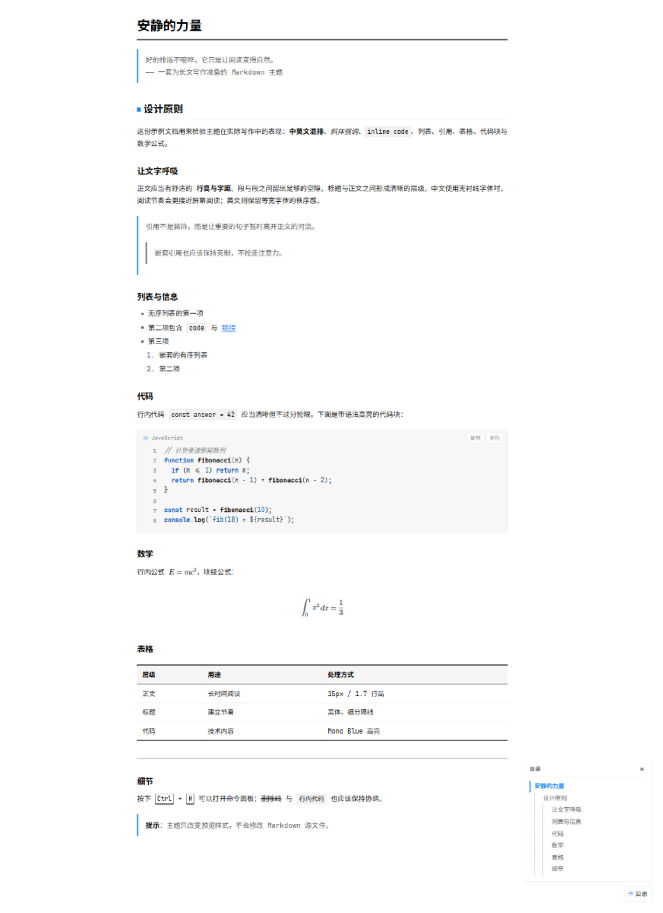
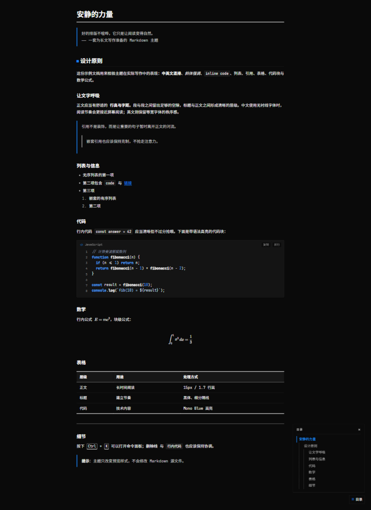
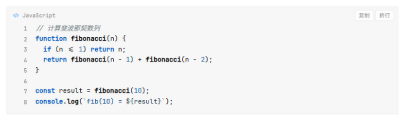
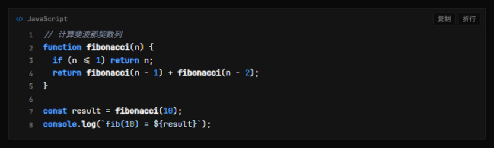

<div align="center">
  
  <h1>Mono Markdown Preview</h1>
  <p><strong>安静、清晰，只留下内容。</strong><br>
  为 VS Code 原生 Markdown 预览打造的极简主题。</p>

  <p>
    <a href="https://github.com/GitZhiQing/mono-markdown-preview/actions/workflows/ci.yml"></a>
    <a href="https://github.com/GitZhiQing/mono-markdown-preview/releases"></a>
    <a href="LICENSE"></a>
    
  </p>
</div>

---

<p align="center">
  <a href="docs/screenshots/readme-light.png"></a>
  <a href="docs/screenshots/readme-dark.png"></a>
</p>

<p align="center"><sub>亮色 · Light&nbsp;&nbsp;&nbsp;&nbsp;暗色 · Dark</sub><br>
<sub>同一篇文档，自动跟随 VS Code 的亮色与暗色主题。点击图片查看原图。</sub></p>

## 阅读优先

以黑白灰建立秩序，蓝色 `#1a88ff` 只做强调。没有卡片、渐变和阴影，只有清楚的层级、舒服的行距，以及足够安静的留白。

- **字体**：英文 JetBrains Mono / Cascadia Code，中文回退到 Noto Sans SC / 微软雅黑
- **标题**：H1 粗下划线，H2 细分隔线加蓝色方块
- **引用**：3px 蓝色左线，无底色、无圆角
- **表格**：上下强边框，表头轻底色
- **细节**：直角图片、细滚动条、克制的分隔线

## 代码块

代码块使用 Mono Blue 高亮：关键字、函数、字符串、数字、标签和属性分属不同的蓝灰层级。每个代码块都有语言图标和名称、逻辑行号、单块折行开关与复制按钮。

<p align="center"><sub>亮色</sub></p>



<p align="center"><sub>暗色</sub></p>



- 左上角显示 `</>` 和语言名称；没有语言标记时显示 `Code`
- 左侧行号按逻辑行计数；复制时保留原始换行，不包含行号
- 右上角 **复制** 复制整段代码，**折行** 只切换当前代码块
- 如果开启了 `markdown.preview.wordWrap`，代码块默认折行，按钮显示 **不折行**

## 数学公式

原生预览使用 VS Code 内置的 KaTeX，行内和块级公式都保持清晰：

```markdown
行内公式 $E = mc^2$。

$$
\int_0^1 x^2 \, dx = \frac{1}{3}
$$
```

导出的 HTML 会自动内联 KaTeX 样式与 woff2 字体，不依赖网络。公式支持 `$...$` 和 `$$...$$`，请保持内置 `markdown-math` 扩展启用。

## 目录与导出

- **浮动目录**：`h1`–`h4` 自动生成，按层级嵌套；每级带垂直虚线，当前章节保持蓝色，`Esc` 或点击外部关闭。
- **浏览器打开**：预览右下角的地球图标、编辑器标题栏按钮、命令面板或右键菜单。
- **独立 HTML**：本地图片内联为 data URI，代码块增强和目录一并保留；服务不可用时生成 `<文件名>.mono.html`。
- **主题联动**：导出页跟随系统深浅色，打印时切换到浅色配色。

## 安装

从 [Releases](https://github.com/GitZhiQing/mono-markdown-preview/releases) 下载最新的 `.vsix`：

```powershell
code --install-extension mono-markdown-preview-1.4.0.vsix
```

也可以在 VS Code 扩展面板里点 `...` → **Install from VSIX**。安装或升级后，执行 **Developer: Reload Window**。

## 使用

1. 打开 Markdown 文件。
2. 按 `Ctrl+Shift+V` 打开原生预览。
3. 点右下角 **目录** 查看大纲；点地球图标在浏览器中打开 HTML 版本。

## 开发

需要 Node.js 18+，运行时没有第三方依赖。

```bash
npm test          # 纯函数测试 + 本地导出服务测试
npm run package   # 生成 VSIX
```

在 VS Code 里打开项目后按 `F5` 可以启动扩展开发宿主。更完整的设计说明和排查记录见 [docs/NATIVE-PREVIEW.md](docs/NATIVE-PREVIEW.md)。

## 已知限制

- VS Code 原生预览不渲染任务清单勾选框
- Mermaid 等依赖预览脚本的内容，导出的 HTML 可能显示不完整
- 数学公式请使用 `$...$` / `$$...$$`；VS Code 内置数学扩展不识别 `\(...\)` 和 `\[...\]`
- 导出的 HTML 主要面向标准 Markdown，指向其他本地文件的相对链接不会自动转换

## 许可

MIT，见 [LICENSE](LICENSE)。代码高亮基于 highlight.js 的 Mono Blue 主题，公式样式与字体来自 KaTeX；第三方许可见 [THIRD-PARTY-NOTICES.md](THIRD-PARTY-NOTICES.md)。

<details>
<summary>发布到 VS Code Marketplace</summary>

1. 把 `package.json` 里的 `publisher` 改成真实 publisher ID。
2. 在 <https://marketplace.visualstudio.com/manage> 创建 publisher，并生成 Marketplace PAT。
3. 运行：

```powershell
npx @vscode/vsce login <publisher-id>
npx @vscode/vsce publish --no-dependencies
```

VSCodium / Open VSX 可以用 `ovsx` 发布同一个 VSIX。

</details>
