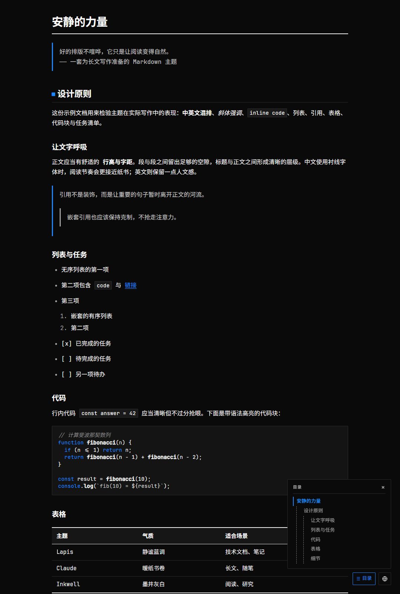
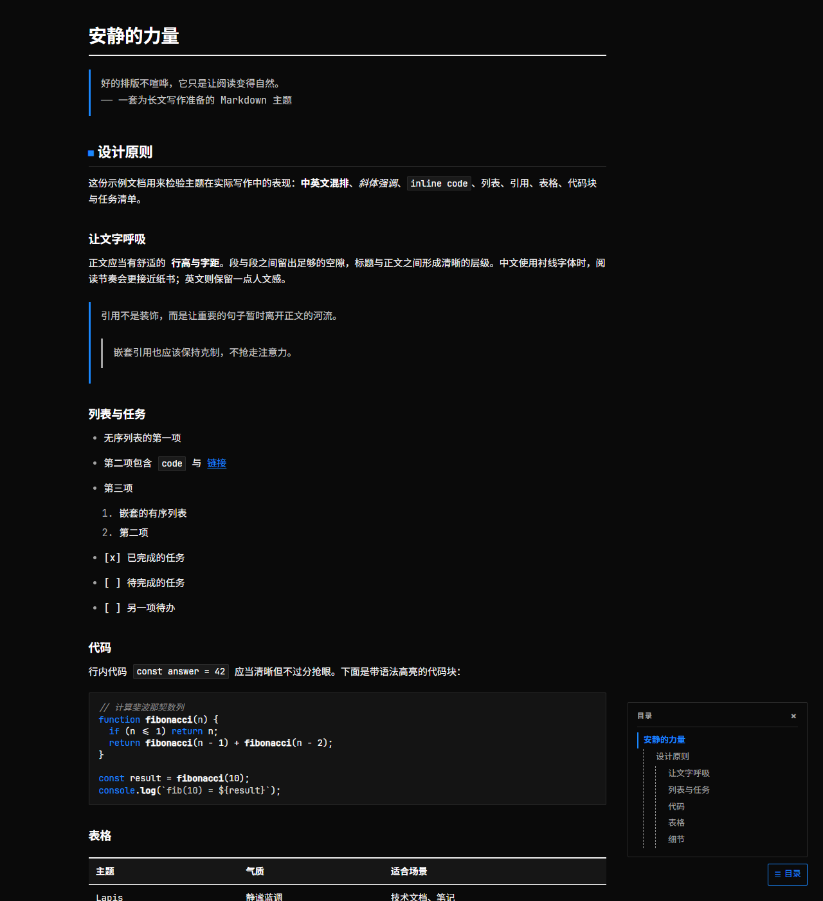
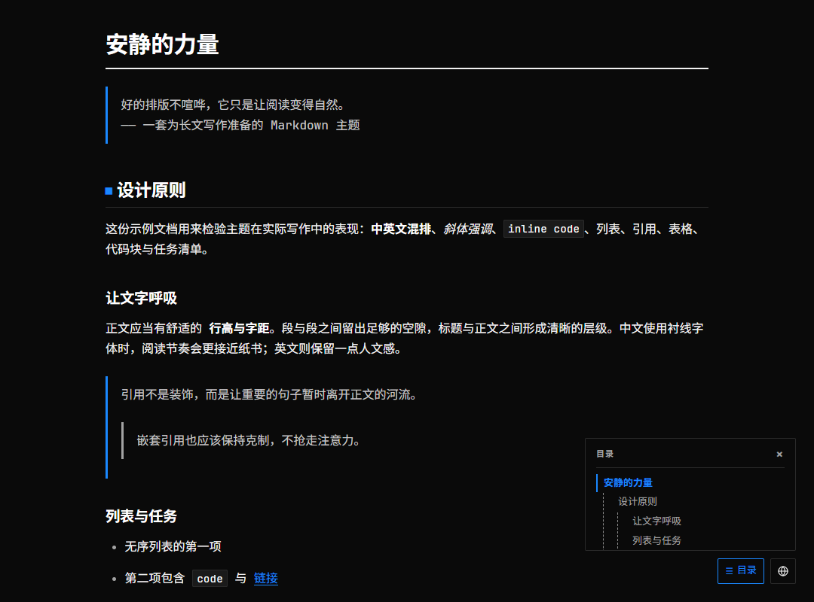

# Mono Markdown Preview

给 VS Code 原生 Markdown 预览用的极简主题。以黑白灰为主，蓝色 `#1a88ff` 只做点缀；英文使用等宽字体，中文回退到黑体。附带浮动目录和“在浏览器打开 HTML”。

仓库：<https://github.com/GitZhiQing/mono-markdown-preview>  
CI：<https://github.com/GitZhiQing/mono-markdown-preview/actions/workflows/ci.yml>

[](https://github.com/GitZhiQing/mono-markdown-preview/actions/workflows/ci.yml)



## 特点

- 高对比黑白灰，自动跟随 VS Code 的亮色、暗色和高对比主题
- 英文 JetBrains Mono，中文 Noto Sans SC / 微软雅黑
- 标题、引用、表格、代码块、图片都按印刷风格处理，不用大圆角、渐变和阴影
- 细滚动条：8px、透明轨道、悬停变蓝、无上下箭头
- 浮动目录：按标题层级嵌套，带垂直虚线，当前章节蓝色高亮
- 在浏览器打开：预览里的地球按钮，或编辑器标题栏的浏览器图标





## 安装

从 VSIX 安装：

```powershell
code --install-extension mono-markdown-preview-1.3.3.vsix
```

也可以在 VS Code 扩展面板里点 `...` → **Install from VSIX**。

## 使用

1. 打开 Markdown 文件。
2. 按 `Ctrl+Shift+V` 打开原生预览。
3. 点右下角 **目录** 查看大纲；点地球图标在浏览器中打开 HTML 版本。

## 目录

- `h1`–`h4` 自动生成，按层级嵌套
- 每一级左侧有垂直虚线，缩进更清楚
- 点击条目平滑滚动，当前章节保持蓝色
- `Esc` 或点击面板外部关闭
- 内容变化时自动更新；少于两个标题时隐藏
- 打印时隐藏，导出的 HTML 里同样保留

## 在浏览器打开

入口：

- 预览右下角、**目录** 按钮右侧的地球图标
- 编辑器标题栏的浏览器图标
- 命令面板：`Mono: 在浏览器打开 HTML`
- 编辑器或资源管理器里右键 `.md` 文件

有本地服务时，浏览器直接打开渲染好的 HTML；服务不可用时，编辑器标题栏/命令面板会生成 `<文件名>.mono.html` 文件。

## 本地导出服务

- 只监听 `127.0.0.1:48765`，需要 token
- 打开 Markdown 文件或执行命令时才启动，不在 VS Code 启动时占端口
- 只渲染 Markdown，本地图片会内联成 data URI
- 不开多个 VS Code 窗口时一般不会有问题；多窗口只有第一个能占用端口，其他窗口请用编辑器标题栏的浏览器图标
- 仅支持本地工作区，远程/虚拟工作区不可用

## 已知限制

- VS Code 原生预览不渲染任务清单勾选框
- Mermaid、数学公式等依赖预览脚本的内容，导出的 HTML 可能显示不完整
- 导出的 HTML 主要面向标准 Markdown，指向其他本地文件的相对链接不会自动转换

## 开发

需要 Node.js 18+。运行时没有第三方依赖。

```bash
npm test          # 纯函数测试 + 本地导出服务测试
npm run package   # 生成 VSIX
```

在 VS Code 里打开项目后按 `F5`，可以启动扩展开发宿主调试。

`npm run package` 会在项目根目录生成 `.vsix`，并自动把 README 里的相对图片地址改写为仓库地址。

## 项目结构

```text
src/
  extension.js          命令与本地导出服务
  lib/
    build-html.js       独立 HTML 模板
    inline-images.js    本地图片转 data URI
media/
  mono.css              预览样式
  toc.css / toc.js      目录样式与脚本
  vscode-markdown.css   导出用基础样式
  vscode-highlight.css
  icon.png / icon.svg
test/
  pure.test.js
  export-server.test.js
  fixtures/
docs/
  NATIVE-PREVIEW.md
  screenshots/
.github/workflows/package.yml
package.json
CHANGELOG.md
SECURITY.md
LICENSE
```

## 发布

仓库和 GitHub Actions 已经配置好：

- 推送到 `main`：自动跑测试、打包 VSIX，并上传构建产物。
- 推送 `v*` tag：额外校验 tag 与版本号，创建 GitHub Release，附上 VSIX。

如果要上架 VS Code Marketplace，还需要：

1. 把 `package.json` 里的 `publisher` 改成真实 publisher ID
2. 在 <https://marketplace.visualstudio.com/manage> 创建 publisher，并生成 Marketplace PAT
3. 运行：

```powershell
npx @vscode/vsce login <publisher-id>
npx @vscode/vsce publish --no-dependencies
```

VSCodium / Open VSX 可以用 `ovsx` 发布同一个 VSIX。

## 许可

MIT，见 [LICENSE](LICENSE)。
